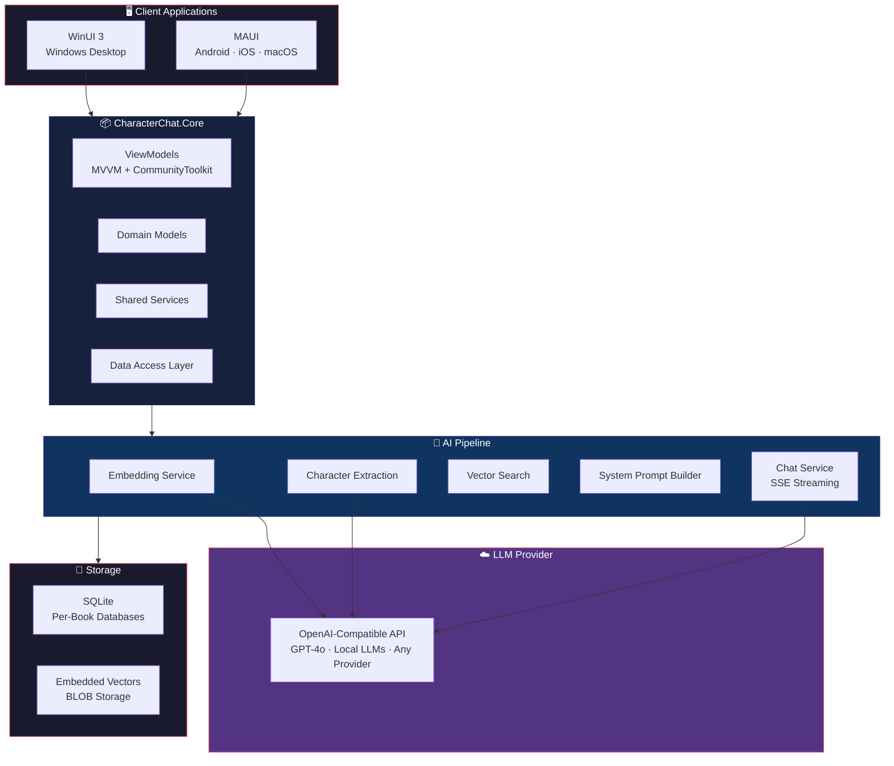
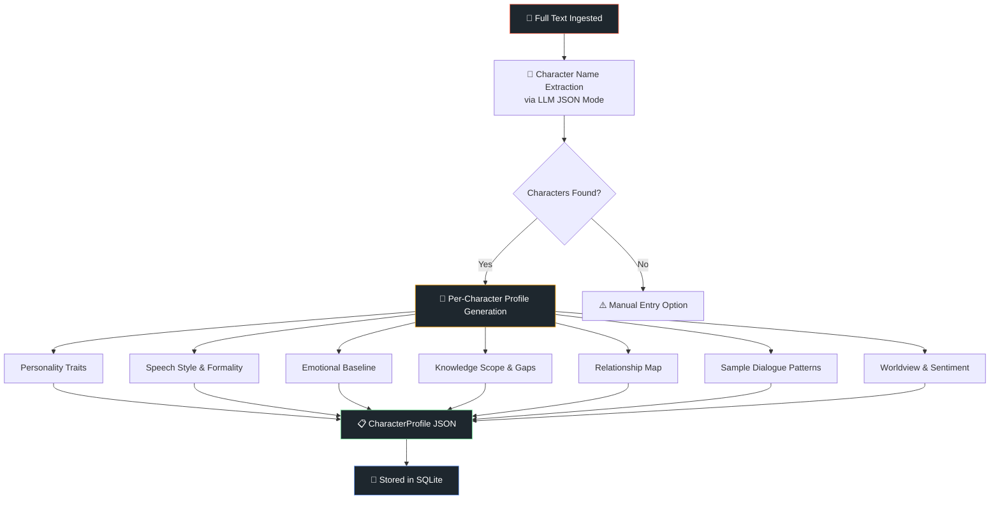
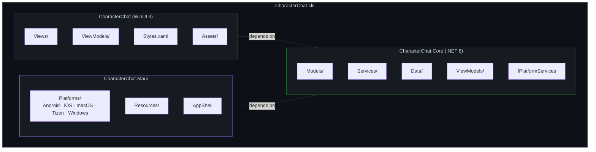
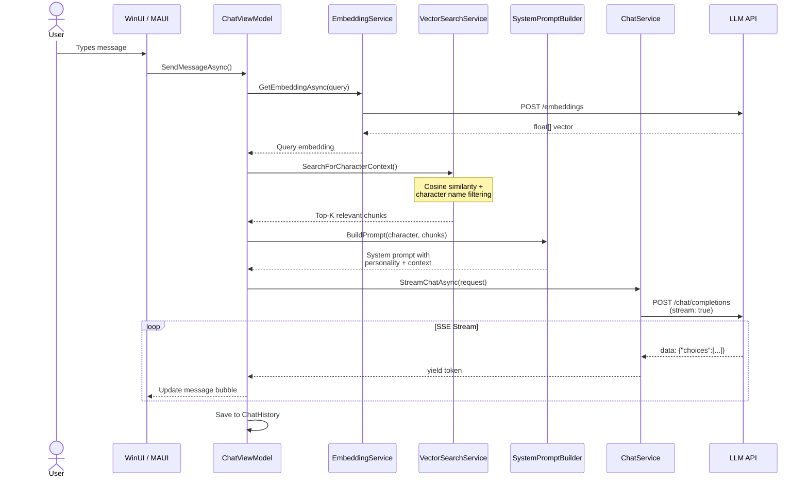
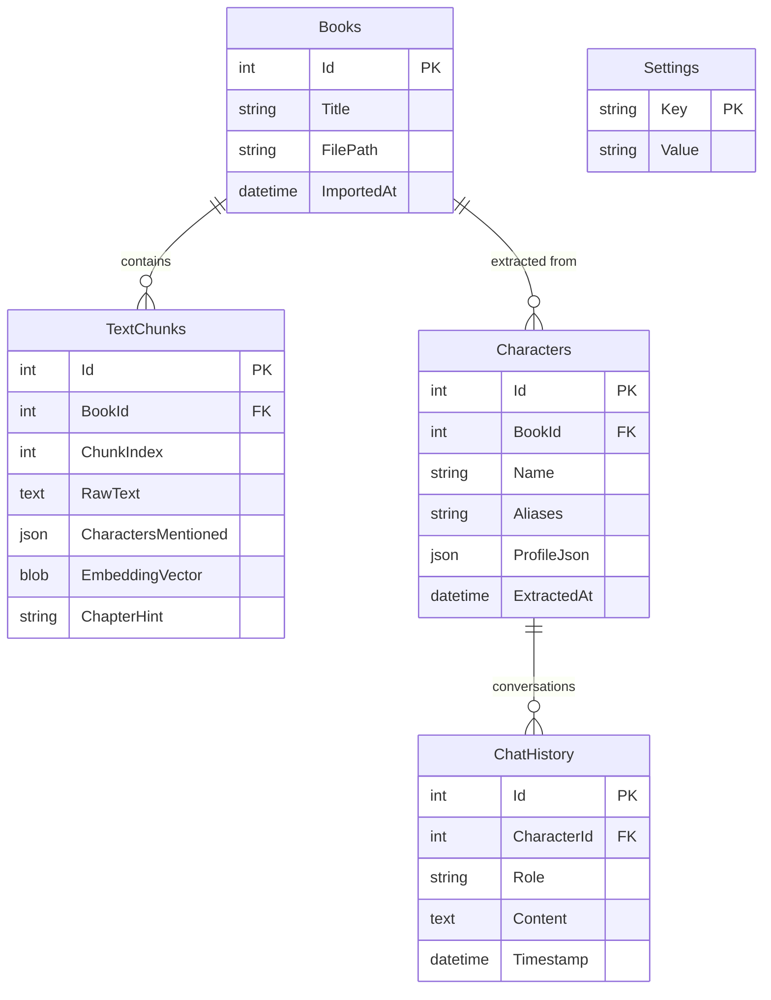
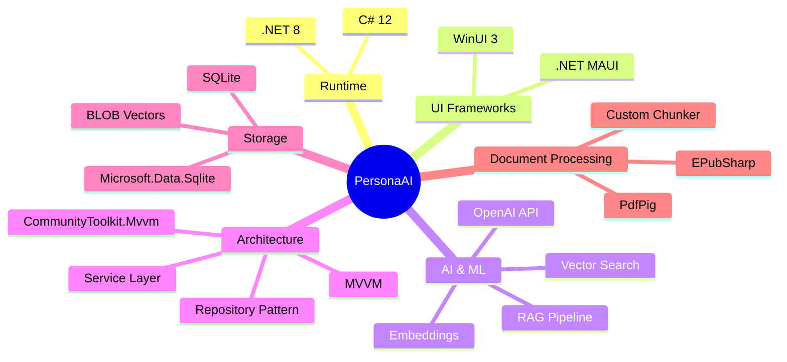
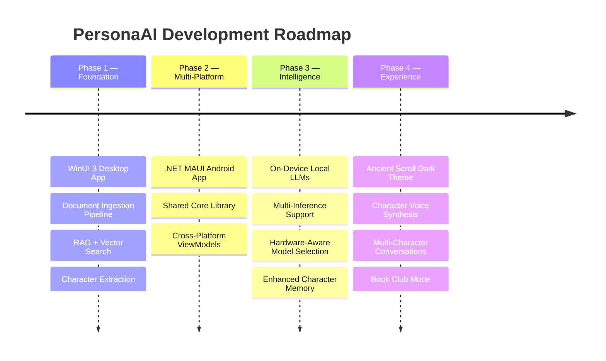

  
  
  
  
  

  
  
  
  
  

<h1 align="center">📖 PersonaAI — CharacterChat</h1>

  <strong>Upload a book. Extract its characters. Talk to them as if they were real.</strong>

  <em>An AI-powered literary character conversation engine that uses Retrieval-Augmented Generation (RAG) to ground responses in canonical text — so characters never break character, hallucinate, or know things they shouldn't.</em>

---

## 🧠 What Is This?

**PersonaAI** is a desktop application that lets you have genuine conversations with fictional characters extracted from novels, stories, or any narrative text. Unlike generic chatbots slapped with a character name, PersonaAI performs deep psychological profiling and retrieval-augmented generation to ensure every response is:

- **Canonically grounded** — responses come from the actual text, not fabricated knowledge
- **Psychologically consistent** — personality traits, speech patterns, and emotional baselines are extracted and enforced
- **Knowledge-bounded** — characters don't know things they shouldn't (no Elizabeth Bennet discussing quantum physics)
- **Contextually aware** — vector search retrieves the most relevant text passages for each conversation turn

---

## 🏗️ System Architecture

---

## 📚 RAG Pipeline

The core intelligence of PersonaAI lives in its **Retrieval-Augmented Generation** pipeline — a multi-stage process that ensures every character response is grounded in their actual literary existence.

```mermaid
graph LR
    A["📄 Upload Book<br/>.txt · .epub · .pdf"] --> B["✂️ Chunking<br/>2000 chars + 200 overlap"]
    B --> C["🧬 Embedding<br/>text-embedding-3-small"]
    C --> D["💾 Store<br/>SQLite + Vector BLOB"]
    D --> E["🔍 Query<br/>Cosine Similarity Search"]
    E --> F["🎭 Character Filter<br/>Strict Name Matching"]
    F --> G["🧠 System Prompt<br/>Personality + Context"]
    G --> H["💬 LLM Response<br/>Streamed via SSE"]

    style A fill:#2d2d44,stroke:#ff6b6b,color:#fff
    style B fill:#2d2d44,stroke:#ffa502,color:#fff
    style C fill:#2d2d44,stroke:#ffd32a,color:#fff
    style D fill:#2d2d44,stroke:#05c46b,color:#fff
    style E fill:#2d2d44,stroke:#0fbcf9,color:#fff
    style F fill:#2d2d44,stroke:#575fcf,color:#fff
    style G fill:#2d2d44,stroke:#d63031,color:#fff
    style H fill:#2d2d44,stroke:#6c5ce7,color:#fff
```

---

## 🎭 Character Extraction Pipeline

When a book is imported, an AI-driven extraction pipeline automatically identifies characters and builds rich psychological profiles:

---

## 📐 Project Structure

---

## ⚡ Key Features

| Feature | Description |
|:--------|:------------|
| 📄 **Multi-Format Import** | Upload `.txt`, `.epub`, and `.pdf` books for character extraction |
| 🧬 **Vector Embeddings** | Every text chunk is embedded and stored for semantic retrieval |
| 🎭 **Deep Character Profiles** | Personality, speech style, knowledge boundaries, and relationships — all extracted automatically |
| 🔍 **Character-Filtered RAG** | Vector search is strictly isolated per character — no cross-contamination |
| 💬 **Streaming Chat** | Real-time Server-Sent Events (SSE) streaming for natural conversation flow |
| 🧠 **Strict Knowledge Boundaries** | Characters refuse to answer questions outside their canonical knowledge scope |
| 🔌 **Any LLM Provider** | Works with OpenAI, local LLMs (Ollama, LM Studio), or any OpenAI-compatible API |
| 💾 **Per-Book Databases** | Each book gets its own SQLite database for clean isolation |
| 🖥️ **Multi-Platform** | WinUI 3 for Windows, MAUI for Android, iOS, macOS, and more |

---

## 🔄 Conversation Flow

---

## 🗄️ Data Model

---

## ⚙️ Technology Stack

---

## 🚀 Getting Started

### Prerequisites

| Requirement | Version |
|:------------|:--------|
| .NET SDK | 8.0+ |
| Visual Studio | 2022 17.8+ |
| Windows App SDK | 1.6+ |
| Windows | 10 (1809+) / 11 |

### Setup

1. **Clone the repository**
2. **Open `CharacterChat.sln`** in Visual Studio 2022
3. **Set the startup project** to `CharacterChat` (WinUI 3) or `CharacterChat.Maui`
4. **Build and run** — the app will create its database on first launch
5. **Configure your LLM** — go to Settings and enter your API endpoint and key

### LLM Configuration

PersonaAI supports any OpenAI-compatible API. Configure through the in-app Settings page:

| Setting | Default | Description |
|:--------|:--------|:------------|
| Base URL | `https://api.openai.com/v1` | API endpoint |
| API Key | — | Your API key |
| Chat Model | `gpt-4o-mini` | Model for chat & extraction |
| Embedding Model | `text-embedding-3-small` | Model for vector embeddings |

> 💡 **Local LLMs:** Set the Base URL to your local server (e.g., `http://localhost:1234/v1` for LM Studio, `http://localhost:11434/v1` for Ollama).

---

## 🗺️ Roadmap

---

## 🤝 Contributing

Contributions are welcome! Please feel free to submit a Pull Request. For major changes, please open an issue first to discuss what you would like to change.

---

## 📄 License

This project is licensed under the MIT License — see the [LICENSE](LICENSE) file for details.

---

  Built with ❤️ and a love for literature

